# Solitude for Blogger

把 [hexo-theme-solitude](https://github.com/everfu/hexo-theme-solitude) 的视觉设计与阅读体验移植到 Blogger平台，可直接导入的单文件 XML 主题**。

> 说明：这不是把 Hexo 主题文件改个后缀就能用的"搬运"。Hexo 是构建期静态生成，Blogger 是服务端 XML 模板 + 小工具（widget）体系，两者数据模型不同。本项目重写了模板结构、样式与交互脚本，保留原主题的配色变量、卡片布局、明暗双主题、首页顶部、侧栏卡片、悬浮工具栏等视觉特征，并用 Blogger 原生能力重新实现数据部分。
>
> 演示站：[https://blog.320826.xyz/](https://blog.320826.xyz/)

<p align="center">
  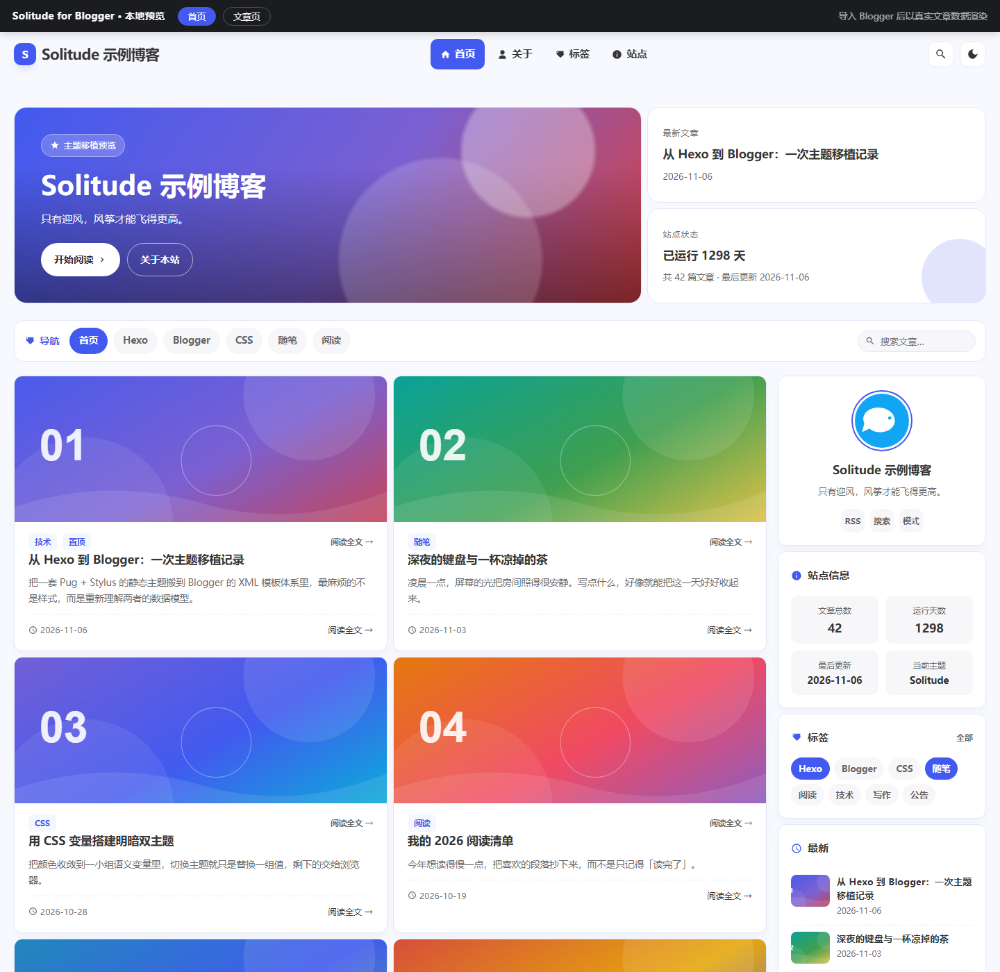
</p>

<p align="center"><sub>首页实际渲染效果 · 更多截图见下方 <a href="#界面预览">界面预览</a></sub></p>

## 交付文件


```
├── README.md                    项目说明（含界面预览）
├── solitude-blogger.xml         主题代码——在BLogger后台——主题背景——自定义还原上传本文件
└── screenshots/                 全部预览截图（13 张），README引用
```


## 界面预览


### 首页与文章页（亮色）

| 首页                                  | 文章页                                  |
| ----------------------------------- | ------------------------------------ |
|  | 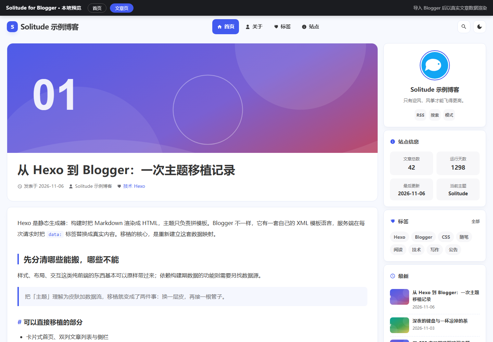 |

### 文章页（暗色）

<p align="center">
  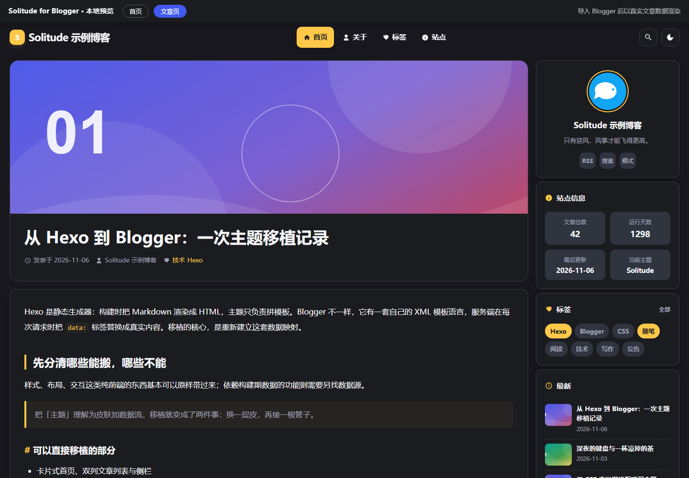
</p>

### 侧边栏特写

<p align="center">
  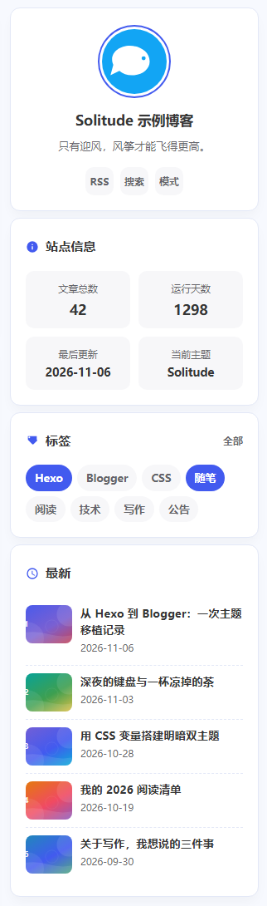
</p>

顺序为：作者信息卡 → 站点信息 → 标签 → 最新 → 文章目录。

### 「关于」弹窗

| 亮色                                     | 暗色                                            |
| -------------------------------------- | --------------------------------------------- |
| 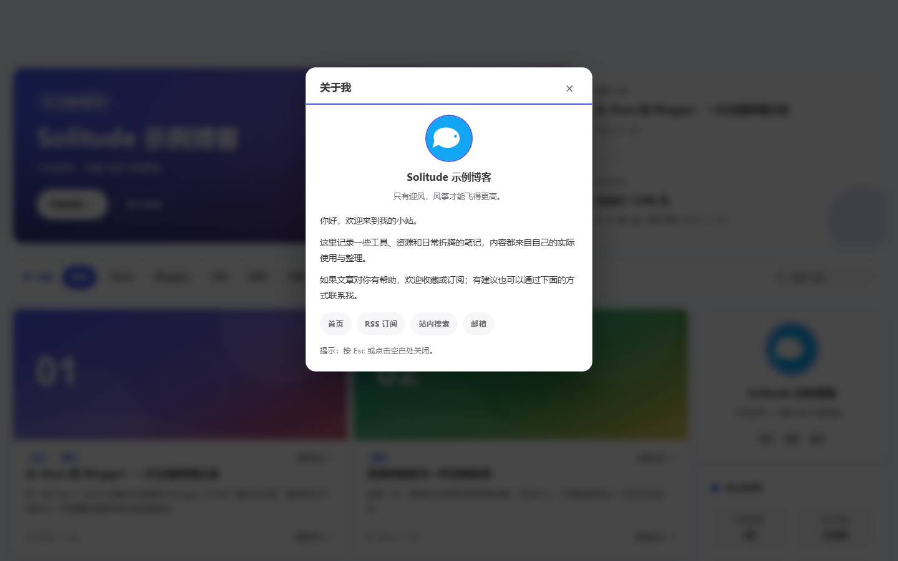 | 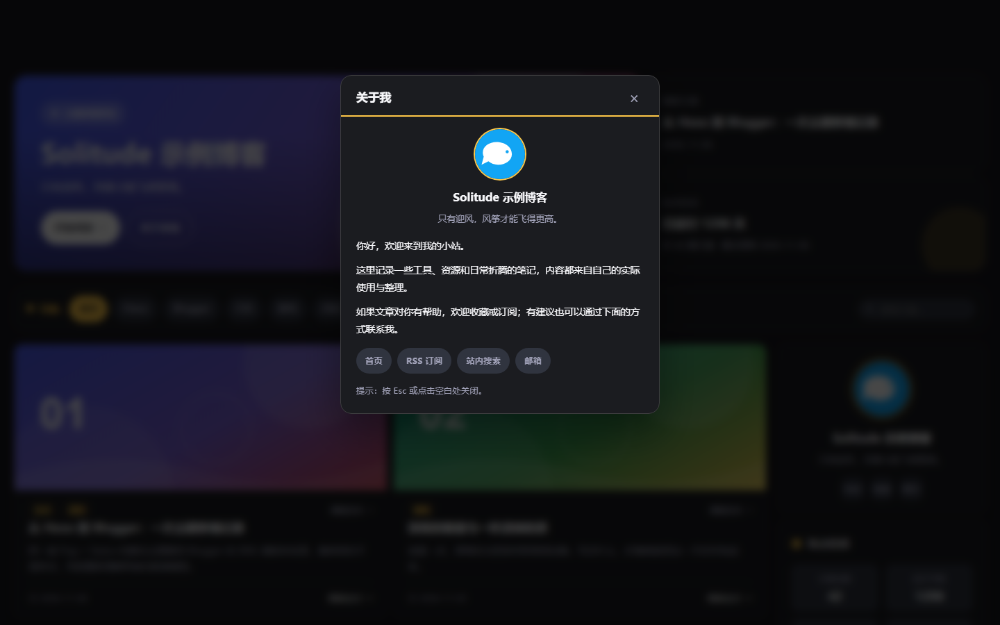 |

<p align="center">
  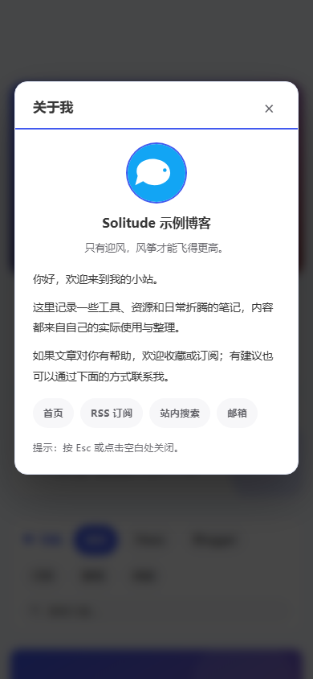
</p>

<p align="center"><sub>手机视图 · 390px</sub></p>

### 页脚（Solitude 3.0 三层结构）

| 亮色                                            | 暗色                                           |
| --------------------------------------------- | -------------------------------------------- |
| 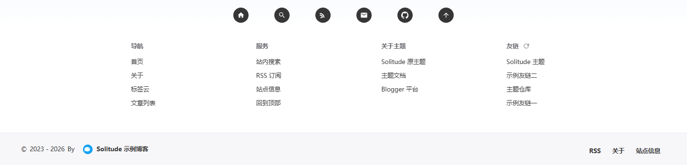 | 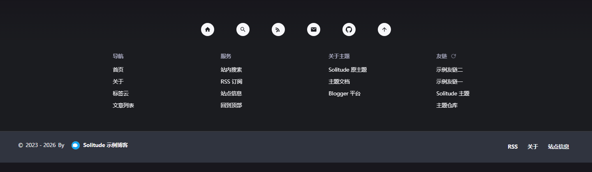 |

<p align="center">
  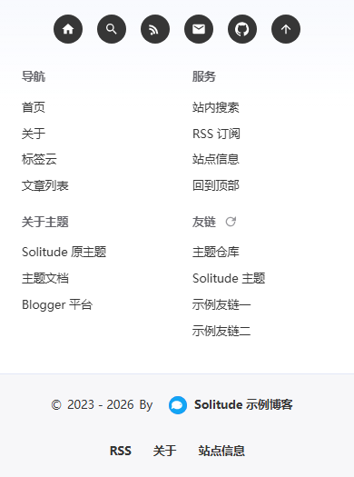
</p>

<p align="center"><sub>手机视图 · 390px</sub></p>

6 个圆形按钮（首页 / 搜索 / RSS / 邮箱 / GitHub / 回到顶部），中间的大圆头像已按需求删除。

### 版权块、评论区与 RSS 订阅

| 版权块 + 评论区                                    | 评论区特写                                    |
| -------------------------------------------- | ---------------------------------------- |
| 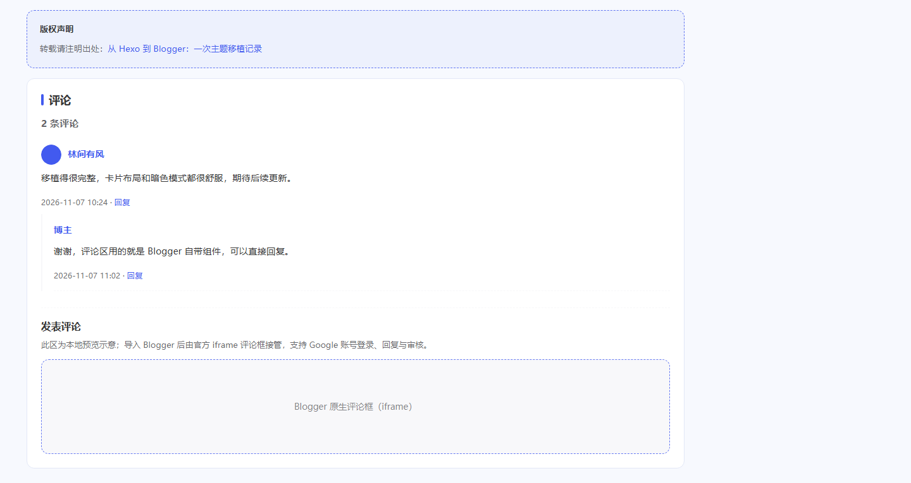 | 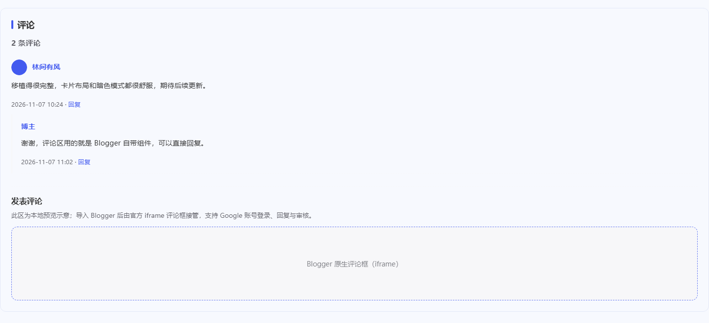 |

<p align="center">
  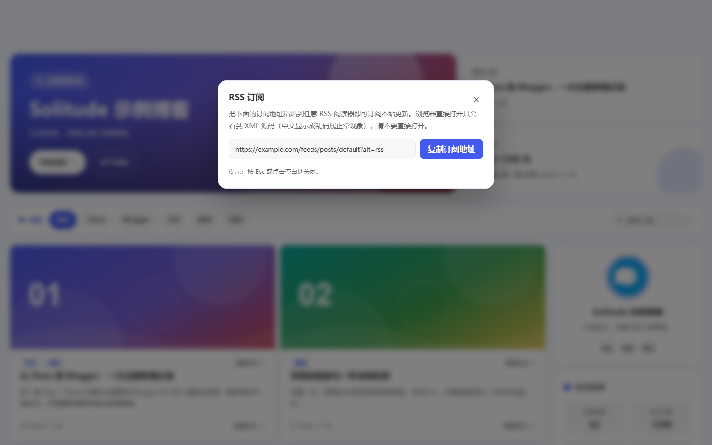
</p>

<p align="center"><sub>RSS 订阅面板 · 展示 <code>?alt=rss</code> 地址，不再跳转 XML</sub></p>

### 修改「关于」弹窗内容

在 `window.SOLITUDE_CONFIG` 里找到 `about`：

```js
    about: {
      title: '关于我',
      paragraphs: [
        '你好，欢迎来到我的小站。',
        '这里记录一些工具、资源和日常折腾的笔记，内容都来自自己的实际使用与整理。',
        '如果文章对你有帮助，欢迎收藏或订阅；有建议也可以通过下面的方式联系我。'
      ],
      links: [
        { name: '首页', url: '/' },
        { name: 'RSS 订阅', url: '#', action: 'rss' },
        { name: '站内搜索', url: '#search', action: 'search' }
      ]
    }
```

- `paragraphs` 一行一段，可自由增删；文字里**不要带英文单引号** `'`，逗号规则与友链一致（最后一行不要逗号）。
- `links` 里的 `action` 可用 `'rss'`（弹订阅面板）、`'search'`（打开搜索）、`'top'`（回顶部）；普通外链写完整 `https://` 地址，站内页面写 `/p/xxx.html`。
- **邮箱入口不用填**：填了上面的 `email` 后，弹窗底部会自动多一个「邮箱」按钮。
- 弹窗的头像、名称、简介不需要在这里配置，会自动读取 Blogger 后台数据。

## 常用配置速查：友情链接 / 邮箱地址

### 配置在哪里

所有常用配置都集中在 `solitude-blogger.xml` 的 `<head>` 里这一段（前面是样式，直接按 <kbd>Ctrl</kbd>+<kbd>F</kbd> 搜 `SOLITUDE_CONFIG` 最快，约在第 861 行）：

```js
window.SOLITUDE_CONFIG = {
  ...
};
```

**两种改法，效果一样：**

| 场景   | 操作                                                                                                                    |
| ---- | --------------------------------------------------------------------------------------------------------------------- |
| 还没导入 | 用记事本 / VS Code 打开 `solitude-blogger.xml`，按 <kbd>Ctrl</kbd>+<kbd>F</kbd> 搜 `SOLITUDE_CONFIG`，改完保存，再上传到 Blogger         |
| 已经导入 | Blogger 后台 → **主题** → 右上角 **⋮** → **修改 HTML** → 在编辑器里按 <kbd>Ctrl</kbd>+<kbd>F</kbd> 搜 `SOLITUDE_CONFIG` → 改 → 点「保存主题」 |

改完刷新前台页面（有缓存就 <kbd>Ctrl</kbd>+<kbd>F5</kbd>）。**改之前先备份主题**：主题 → ⋮ → 备份。

### ① 配置邮箱地址

在配置块里找到这一行：

```js
    email: '',
```

把邮箱写进单引号里：

```js
    email: 'yourname@example.com',
```

- **只填邮箱本身**，不要带 `mailto:` 前缀，也不要带 `?subject=...`（脚本会自动加上 `mailto:`）。
- 必须用**英文单引号** `'`，不能用中文引号 `“”`。
- 保存后，页脚那排圆形按钮里的**信封按钮**就变成 `mailto:yourname@example.com`，点击直接打开系统邮件客户端。
- 留空 `''` 时点击信封会弹出「还没设置邮箱地址」的提示，不会打开一封收件人为空的邮件。

### ② 修改页脚友情链接

在配置块里找到 `friendLinks` 数组和它下面的 `friendCount`：

```js
    friendLinks: [
      { name: 'Solitude 主题', url: 'https://solitude.js.org/' },
      { name: '主题仓库', url: 'https://github.com/everfu/hexo-theme-solitude' },
      { name: '示例友链一', url: 'https://example.com/' },
      { name: '示例友链二', url: 'https://example.org/' }
    ],
    friendCount: 4,
```

**逐行改成你自己的友链**，一条一行：

```js
    friendLinks: [
      { name: '张三的博客', url: 'https://zhangsan.com/' },
      { name: '某个资源站', url: 'https://example.net/' },
      { name: '我的关于页', url: '/p/about.html' }
    ],
    friendCount: 3,
```

规则：

| 字段            | 说明                                                                 |
| ------------- | ------------------------------------------------------------------ |
| `name`        | 页脚显示的文字，中文、空格都可以；**名字里不要用英文单引号** `'`，会破坏 JS                        |
| `url`         | 外链请写完整地址并带 `https://`；站内页面可写相对路径如 `/p/about.html`                  |
| `action`（可选）  | `'rss'` 弹订阅面板、`'search'` 打开站内搜索、`'top'` 回到顶部；用了它时 `url` 写 `'#'` 即可 |
| 逗号            | 数组里**除最后一行外，每行末尾都要有英文逗号**，最后一行不要；逗号写错会导致整页脚本失效                     |
| `friendCount` | 每次随机显示几条。想让所有友链固定全部显示，把它设成**大于或等于总条数**；点页脚「换一批」按钮会重新随机抽取           |
| 整列隐藏          | 把数组清空写成 `friendLinks: []`，页脚「友链」这一列会自动隐藏                           |

示例（带一个站内动作）：

```js
    friendLinks: [
      { name: '朋友的博客', url: 'https://friend.example.com/' },
      { name: 'RSS 订阅', url: '#', action: 'rss' }
    ],
    friendCount: 2,
```

> 改完保存前，建议把整个 `window.SOLITUDE_CONFIG = { ... };` 复制一份到记事本留底；一旦引号或逗号写错，Blogger 编辑器不会帮你检查 JS 语法，页面交互会整个停掉，重新粘贴原始片段即可恢复。

### ③ 完整配置块（可对照）

```js
window.SOLITUDE_CONFIG = {
  siteSince: '2023-04-20',   // 建站日期，用于「运行天数」
  authorName: '',            // 留空 = 使用 Blogger 博客标题
  authorDesc: '',            // 留空 = 读取后台「设置 → 基本 → 说明」
  heroDesc: '',              // 留空 = 同样读取后台说明（首页副标题）
  avatar: '',                // 手动头像 URL（最低优先级的回退）
  useFaviconAvatar: true,    // 头像优先用后台「布局 → 网站图标」
  useProfileAvatar: true,    // 次选：后台个人资料头像
  heroTitle: '',             // 首页大标题；留空 = 博客标题
  heroKicker: '欢迎光临',
  defaultCover: '',          // 无图文章的兜底封面 URL；留空为渐变色块
  highlightTags: [],         // 高亮标签，例如 ['Hexo', '随笔']
  newestCount: 5,            // 侧栏「最新」条数
  feedMax: 12,               // Feed 取回的文章数（封面 / 最新 / 统计）
  email: '',                 // ① 邮箱：填成 'me@example.com'
  friendLinks: [ ... ],      // ② 友情链接数组，见上一节
  friendCount: 4,            // ② 每次显示几条
  feedUrl: '',               // 留空 = 自动生成 博客根 + feeds/posts/default?alt=rss
  about: { ... }             // ④ 「关于」弹窗，见上一节
};
```

还有 `feedTimeout`（默认 6000 毫秒）与 `footerStartYear` / `footerSocial` / `footerGroups` / `footerBeian` / `footerRight`，省略即使用 `theme.js` 里的默认值。

导航里所有「关于」入口现在统一打开弹窗，不再需要预先创建 `/p/` 静态页面。亮色主色 `#425AEF`、暗色主色 `#ffc848` 在 `b:skin` 顶部变量区修改。

## 导入步骤

1. **先备份**：Blogger 后台 → 主题 → 右上角 ⋮ → 备份，下载当前主题。
2. 主题 → ⋮ → 修改 HTML，或直接用「恢复」上传 `solitude-blogger.xml`。
3. 若采用粘贴方式：全选编辑器内容，删除，粘贴 `solitude-blogger.xml` 全部内容，保存。
4. 到「布局」确认 `Label1`（标签）小工具存在；`Header1`（页首）与 `Profile1`（个人资料）是模板内置的**隐藏数据源**，不要删除。
5. 在「设置 → 基本 → 说明」填一句话，侧栏信息卡简介与首页副标题会自动显示它。
6. 在「布局 → 网站图标」上传方形图标（建议小于 100 KB），侧栏信息卡头像与页脚版权条的小头像会用它；未上传时自动回退到「布局 → 个人资料」的照片。
7. 在「设置 → 评论」把**评论位置**设为「嵌入式评论」并保存，同时确认文章允许评论。模板已固定输出嵌入评论框，但后台设置仍决定 Blogger 是否提供完整的 iframe 参数。
8. 按上节速查，在 `SOLITUDE_CONFIG` 里填 `email`，并把 `friendLinks` 换成自己的友链。
9. 原来的 HTML/JavaScript 侧栏小工具可以在「布局 → `sidebar` 区域」重新添加（`showaddelement='yes'`）；模板内置的侧栏卡片见下文。
10. 预览首页、文章页、标签页、搜索页、手机视图，确认无异常。

> 建议先在测试博客或非高峰时段操作。Blogger 模板编辑器对 XML 良构要求很严格，本项目已做静态校验，但**未经过真实 Blogger 账号导入验证**（当前环境没有你的 Blogger 授权），请以实际导入结果为准，备份务必保留。

## 后台数据从哪来

模板里有一组隐藏节点，由 Blogger **服务端直接渲染**，前端脚本只读取已经渲染好的 DOM，不额外发请求、不猜测作者、不改写图片 URL：

| 后台字段           | 数据标签 / 来源                                                           | 输出到              |
| -------------- | ------------------------------------------------------------------- | ---------------- |
| 布局 → 网站图标      | `data:blog.homepageUrl + "favicon.ico"` 与 head 里的 `link[rel~=icon]` | 侧栏信息卡头像、页脚版权条小头像 |
| 布局 → 个人资料 → 头像 | `Profile1` 的 `data:photo.url`、文章页 `data:post.authorPhoto.url`       | 同上（网站图标加载失败时的回退） |
| 设置 → 基本 → 说明   | `Header1` 的 `data:description`（与「布局 → 页首」的说明同步）                     | 侧栏信息卡简介、首页副标题    |

Blogger 官方 Layouts Data Tags 中，Page Header 小工具只有 `data:title` 与 `data:description` 两项，全局 `blog` 数据里没有 description 字段。`data:blog.metaDescription` 是「搜索偏好 → 元标记 → 说明」，属于搜索说明，文章页还会变成该文章的搜索说明，**不是**这个「基本 → 说明」，因此模板不使用它。

`Header1` 是本模板唯一的页首小工具（避免同类小工具重复带来的导入兼容问题）。后台说明为空时，两处简介占位会自动隐藏，不会留下空白；想固定文案而不跟随后台，直接给 `authorDesc` / `heroDesc` 填值即可。

**头像优先级**：后台网站图标 → 后台个人资料头像 → `avatar` 手动 URL → 博客名首字。任一地址加载失败会自动尝试下一个，全部失败才回到首字占位。Blogger 的默认占位头像与默认 favicon 会被跳过。按截图要求，**页脚圆形按钮中间那个大头像已删除**，现在头像只显示在信息卡和版权条两处；回到顶部仍由最右侧的箭头按钮负责。JSON Feed 现在**只**用于封面图、最新文章与站点统计，不再承担头像或简介。


## 功能对照

| 原主题能力                | Blogger 版 | 说明                                            |
| -------------------- | --------- | --------------------------------------------- |
| 卡片式首页、双列文章列表         | ✅         | `#recent-posts` 两列网格，窄屏自动单列                   |
| 页脚三层结构（Solitude 3.0） | ✅         | 6 个圆形按钮/ 分组链接与随机友链 / 左右分栏版权条                  |
| 侧栏                   | ✅         | 信息卡 / 标签云 / 最新 / 站点信息 / 目录；                   |
| RSS 订阅               | ✅         | 不跳转 XML，展示 `?alt=rss` 地址并一键复制，避免乱码            |
| 后台「基本 → 说明」作为简介      | ✅         | `Header1` 的 `data:description`，用于信息卡与首页副标题    |
| 后台「网站图标」作为头像         | ✅         | 同域 `/favicon.ico` 优先，显示在信息卡与版权条两处，失败自动回退      |
| 首页顶部 Banner / 推荐位    | ✅         | 大 Banner + 最新文章 / 站点状态两张卡                     |
| 明暗双主题（ColorMode）     | ✅         | 记忆偏好 + 跟随系统，渲染前应用避免闪屏                         |
| 导航、悬浮工具栏、回到顶部        | ✅         | 含滚动隐藏导航、阅读进度条                                 |
| 文章页排版、版权块、标签         | ✅         | 版权块只保留「转载请注明出处：文章标题」，已删除「本文由 … 原创」            |
| 评论                   | ✅         | 无条件输出 Blogger 原生 iframe 嵌入评论框，不再受后台「评论位置」分支影响 |
| 国内访问                 | ✅         | 零外部字体/脚本、系统字体栈、Feed 超时回退、侧栏不嵌第三方 iframe       |
| 搜索                   | ✅         | 使用 Blogger `/search`，支持 `/` 快捷键与弹层            |

## 数据映射（实现要点）

| 内容                | Blogger 标签                                                                                                                                                      |
| ----------------- | --------------------------------------------------------------------------------------------------------------------------------------------------------------- |
| 文章列表              | `<b:loop values='data:posts' var='post'>`                                                                                                                       |
| 列表页 / 文章页判断       | `data:view.isMultipleItems`                                                                                                                                     |
| 摘要                | `<b:eval expr='data:post.body snippet { length: 150, links: false, linebreaks: false }'/>`                                                                      |
| 标题 / 链接 / 正文 / 时间 | `data:post.title` / `data:post.url` / `data:post.body` / `data:post.timestamp`                                                                                  |
| 标签 / 标签云          | `data:post.labels`、`Label` 小工具的 `data:labels`                                                                                                                   |
| 分页                | `data:newerPageUrl` / `data:olderPageUrl`                                                                                                                       |
| 后台说明              | `Header1` 小工具的 `data:description`                                                                                                                               |
| 后台网站图标            | `data:blog.homepageUrl + "favicon.ico"`、`link[rel~=icon]`                                                                                                       |
| 后台头像（回退）          | `Profile1` 的 `data:photo.url`、`data:post.authorPhoto.url`                                                                                                       |
| RSS 地址            | `data:blog.homepageUrl + "feeds/posts/default?alt=rss"`（可由 `feedUrl` 覆盖）                                                                                        |
| 评论                | `<b:include data='post' name='comment_picker'/>` + 全套 `b:includable`；`data:post.commentHtml`、`data:post.comments` 循环、`data:post.commentFormIframeSrc` 原生 iframe |

**评论区**：模板在 `Blog1` 内显式定义了 `comment_picker` / `commentPicker`（驼峰别名，兼容新版引擎）/ `threaded_comments` / `comments` / `comment-list` / `comment-entry` / `comment-form` / `threaded-comment-form` / `commentDeleteIcon` / `comment_count_picker` / `iframe_comments`。线程评论优先用服务端渲染好的 `data:post.commentHtml`，为空时回退到 `data:post.comments` 循环。

按你的要求**固定使用嵌入评论框**：`comment-entry` 无条件输出 `comment-form`（不再依赖 `data:post.embedCommentForm` / `allowNewComments` 判断），因此即使后台「评论位置」是「整页」或「弹出式窗口」，文章下方也会出现评论框；下面另附一个「在新页面发表评论」链接作为兜底。评论容器也不再用 `allowComments` 整体包裹，避免整块被吞成空白。**后台仍建议把评论位置设为「嵌入式评论」并保存**，这样 Blogger 才会提供完整的 iframe 参数。

评论框本体是 Blogger 的同源 iframe，外层 CSS 只能影响容器与 `color-scheme`；`comment-form` 里保留了 `commentFormIframeSrc` / `cmtfpIframe` / `BLOG_CMT_createIframe` 三件套。

**封面图**：请求博客自己的 `/feeds/posts/summary?alt=json` 取回 `media$thumbnail`，按文章链接回填并放大；超时或失败时回退成渐变色块（显示标题首字）。因此文章里最好有一张图片作为封面来源。

## 常见问题

- **怎么改页脚友情链接 / 怎么配邮箱**：见文首「常用配置速查」，改 `SOLITUDE_CONFIG` 里的 `friendLinks` / `friendCount` / `email` 并保存主题。
- **改完配置后整页交互失效（主题切换、搜索都没反应）**：多半是 `friendLinks` 里漏了英文逗号、写了中文引号，或 `name` 里带了英文单引号。把备份里的 `window.SOLITUDE_CONFIG = { ... };` 原样粘回去，再逐行改。
- **友链只显示一部分 / 想全部显示**：`friendCount` 控制每次随机显示条数，把它设成不小于友链总条数即可；`friendLinks: []` 会隐藏整列。
- **RSS 订阅点开是乱码**：那是 Atom XML 源码，不是网页。现在点击任意 RSS 入口都会弹出订阅面板，复制 `?alt=rss` 地址到阅读器即可；不要直接在浏览器打开。想换成自己的订阅服务，设置 `feedUrl`。
- **邮箱按钮点了没反应 / 只弹提示**：`SOLITUDE_CONFIG.email` 还没填，或填成了带 `mailto:` 的完整链接。只填纯邮箱地址，例如 `'me@example.com'`。
- **评论框不出现**：先在「设置 → 评论」把**评论位置**改成「嵌入式评论」并保存，再确认文章允许评论、Cookie 未被浏览器拦截。模板已固定输出嵌入框，若仍为空，多半是 Blogger 的评论 iframe 域名在国内加载失败，可点评论框下方的「在新页面发表评论」链接。
- **信息卡简介是空的**：在「设置 → 基本 → 说明」填一句话；只填「搜索偏好 → 元标记 → 说明」不会生效。也可以给 `authorDesc` / `heroDesc` 直接写死。
- **头像没变成网站图标**：在「布局 → 网站图标」上传方形图片并保存（Blogger 可能需要强刷缓存）；确认 `useFaviconAvatar` 没被设为 `false`。未上传或加载失败会依次回退到个人资料头像、`avatar` 手动 URL、博客名首字。头像现在只出现在信息卡与版权条两处。

## 版权

原主题 [hexo-theme-solitude](https://github.com/everfu/hexo-theme-solitude) 由 @everfu 开发、@zhheo 授权设计，采用 Apache-2.0 许可。本项目为独立编写的 Blogger 移植版，借鉴其视觉结构与配色命名，未复制原主题的 CSS / JS / 图片资源。使用时请尊重原作者署名与许可要求。
